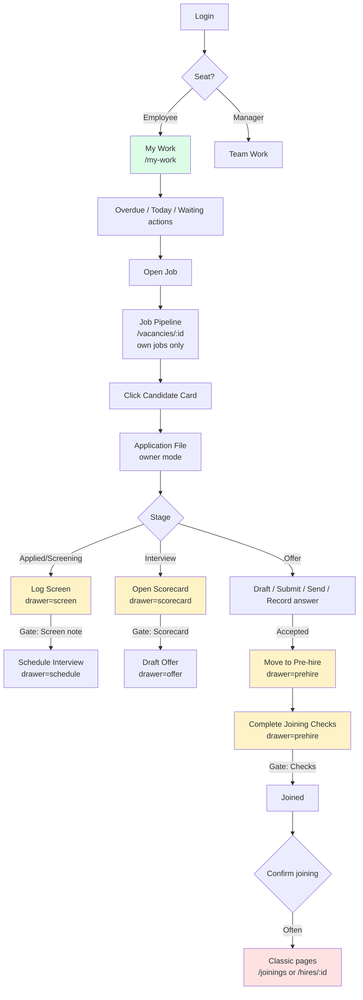
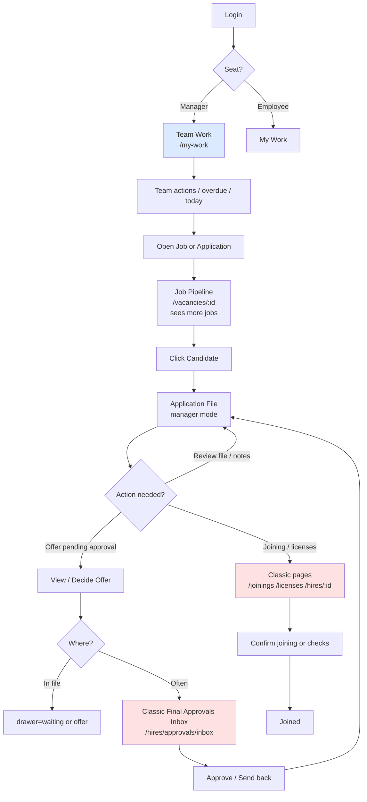
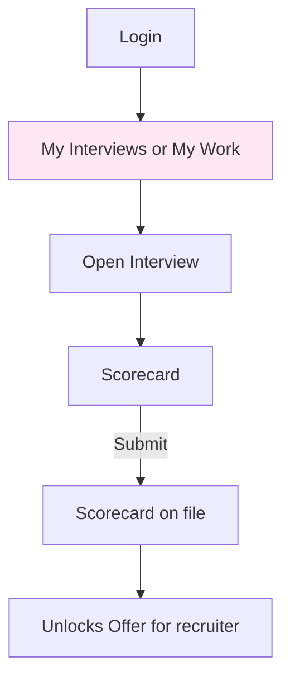

# Hiring Click-Path Matrix (Phase 0) — Full Role Details & Diagrams

**Date:** 26 October 2026  
**Baseline:** Hiring V2 on `main` at `e3602a1`, read from this working tree.  
**Purpose:** Document the current end-to-end hiring click paths (all roles) so Phase 1+ can reduce context loss while keeping compliance gates, RBAC, and audit unchanged.

## Hiring workspace versus `main`

`main` and `origin/main` are `e3602a1`. Destinations, the job pipeline, My Work, the signed-in shell, and `navConfig.ts` match that commit. The `<Route path=` table in `apps/web/src/App.tsx` matches that commit. This working tree only lazy-loads `RequisitionsGate` and `PermissionGate` in that file, and `apps/web/src/v2/pages/my-work.css` only makes two control borders transparent. Neither change redirects a classic URL or changes a hiring click.

The application file in this working tree adds the Phase 1 stage rail, smart action bar, and chatter. Those controls stay on `/applications/:id` and open the drawers named in the stage table. They do not change `destinations.ts`, pipeline moves, My Work hrefs, or the route table. Login, auth, and planning edits elsewhere in the tree are outside this hiring baseline.

All gates listed are enforced server-side. Diagrams use Mermaid.

---

## Stages and Gates (Current V2)

| Stage | Primary next action (`primaryFor`) | Required gate to advance | Drawer opened |
|-------|------------------------------------|---------------------------|---------------|
| Applied / Screening | Log screen (if no screen note) | Screen note saved | `screen` |
| Applied / Screening | Schedule interview (if screen note exists) | — | `schedule` |
| Interview | Schedule interview (if none live) | — | `schedule` |
| Interview | Open scorecard (if interview done, scorecard missing) | Scorecard submitted | `scorecard` |
| Interview | Draft offer (if scorecard exists) | — | `offer` |
| Offer | Draft / Revise offer | — | `offer` |
| Offer | Submit for approval (Draft) | — | `waiting` |
| Offer | View approval (Pending) | — | `waiting` |
| Offer | Send offer (Approved) | — | `send` |
| Offer | Record answer (Sent) | — | `answer` |
| Offer | Move to Pre-hire (Accepted) | Offer accepted | `prehire` |
| Pre-Hire | Pre-hire checklist | Required joining checks verified | `prehire` |
| Joined | — | — | — |

Gates (from `apps/web/src/v2/api/gates.ts`):

- `GATE_SCREEN_NOTE_MISSING` — Interview needs a saved screen note
- `GATE_SCORECARD_NOT_SUBMITTED` — Offer needs a submitted interview scorecard
- `GATE_OFFER_NOT_ACCEPTED` — Pre-hire needs an accepted offer
- `GATE_JOINING_CHECKS_INCOMPLETE` — Joined needs required checks verified
- `GATE_REJECT_REASON_REQUIRED` — Reject needs a reason

---

## Employee (Recruiter) Click Path

Employees land on **My Work**. They own the primary hiring flow and have ownership restrictions.

### Diagram

### Employee differences

| Area | Employee behavior | Notes |
|------|-------------------|-------|
| Home | My Work | Personal overdue / today / waiting / interviews / joining |
| Pipeline access | Own jobs only | Ownership restriction (redacted jobs for others) |
| Application File | Owner mode | Full primary actions (`primaryFor`) |
| Offer approval | Cannot approve | Submits and waits; manager decides |
| Special restrictions | Recruiter-only | Blocked from requisitions and some admin paths |
| Joining | Same friction | Often still jumps to classic pages |

### Primary Employee Happy Path (12 steps)

| Step | Starting place | Action | Lands on | Drawer / next UI | Gate enforced | Notes |
|------|----------------|--------|----------|------------------|---------------|-------|
| 1 | My Work or Open Jobs | Open job | `/vacancies/:id` (Pipeline) | — | — | Kanban of applications |
| 2 | Pipeline | Click candidate card or “Move to” | `/applications/:id` | — | — | Application File opens |
| 3 | Application File (Applied/Screening) | Click primary “Log screen” | Same file | `?drawer=screen` | Screen note | Must save note before Interview |
| 4 | Application File | Click primary “Schedule interview” | Same file | `?drawer=schedule` | — | After screen note |
| 5 | Application File (Interview) | After interview completed | Same file | `?drawer=scorecard` | Scorecard | Interviewer may open via My Interviews |
| 6 | Application File | Click primary “Draft offer” | Same file | `?drawer=offer` | Scorecard submitted | — |
| 7 | Application File | Submit for approval | Same file | `?drawer=waiting` | — | Manager/approver decides |
| 8 | Application File | Send offer (after approval) | Same file | `?drawer=send` | — | — |
| 9 | Application File | Record answer | Same file | `?drawer=answer` | — | Acceptance unlocks Pre-hire |
| 10 | Application File | Move to Pre-hire | Same file | `?drawer=prehire` | Offer accepted | Checklist opens |
| 11 | Application File (Pre-Hire) | Complete required checks | Same file | `?drawer=prehire` | Joining checks | SCFHS / ID / Contract etc. |
| 12 | Application File or classic | Confirm joining | File or `/joinings` / `/hires/:id` | — | Checks complete | Headcount updates; may still hit classic pages |

**Context loss points:** Steps 1→2, My Work links that do not pre-open the drawer, and classic joining/approval pages.

---

## Manager Click Path

Managers land on **Team Work** and have broader visibility. Many approval steps still use classic pages.

### Diagram

### Manager differences

| Area | Manager behavior | Notes |
|------|------------------|-------|
| Home | Team Work | Aggregates team’s work, not just personal |
| Pipeline access | Broader | Can open more jobs (ownership + manager rights) |
| Application File | Manager mode | Can see more (including pay if permitted); some actions read-only |
| Offer approval | Primary responsibility | Often still uses classic `/hires/approvals/inbox` |
| Joining / licenses | Classic pages | Same friction as employee for final confirmation |
| Special roles | Final Hiring Approver, License Specialist | Separate classic homes |

### Typical Manager path (offer approval)
1. Team Work → see pending offer or open job
2. Pipeline or direct link → Application File (manager mode)
3. Open waiting/offer drawer **or** jump to classic Final Approvals Inbox
4. Approve or send back
5. Employee continues (send → record answer → pre-hire)
6. Joining confirmation frequently still lands on classic pages

---

## Interviewer Path

- Limited destinations (interviewer-only users stay near `/my-interviews`).
- Scorecard submission is the main action; unlocks the next stage for the recruiter.

---

## License Specialist / Final Hiring Approver

- Special home: `/licenses` or `/hires/approvals/inbox` (classic).
- Joining checks and final approval still route through classic pages in many cases.
- Can open the Application File in limited (often read-only) mode.

---

## Reject / Withdraw

- Application File → reject drawer (requires reason).
- Gate: `GATE_REJECT_REASON_REQUIRED`.

---

## Entry Points Summary

| Entry | Typical next | Pre-opens drawer? | Notes |
|-------|--------------|-------------------|-------|
| My Work (employee) | Application File or related page | Partial | Links exist; `?drawer=` not always set |
| Team Work (manager) | Application File or classic inbox | Partial | — |
| Open Jobs → Pipeline | Application File | No | Card click goes to file |
| Candidates list | Application File or bank | No | — |
| Classic pages | Various | No | Still active for hires, licenses, offers list, calendar, approvals |

---

## Context-Loss Points (All Roles)

1. Leaving Pipeline or My Work to open the Application File (no drawer pre-open).
2. Offer approval often jumps to classic Final Approvals Inbox.
3. Joining confirmation and license steps frequently leave V2 for classic pages (`/joinings`, `/licenses`, `/hires/:id`).
4. My Work / Team Work actions do not consistently deep-link with `?drawer=`.

---

## Phase 0 Completion Criteria

- [x] Stages and gates documented
- [x] Employee (recruiter) happy path mapped with diagram
- [x] Manager path mapped with diagram
- [x] Interviewer path mapped with diagram
- [x] Divergent roles noted (license specialist, final approver, reject)
- [x] Entry points and context-loss points identified
- [x] Hiring workspace compared with `main` at `e3602a1` (see the section above)
- [x] Classic staff inventory verified against the live `<Route path=` table in `apps/web/src/App.tsx` (see the section below)

## Classic staff routes (from `apps/web/src/App.tsx`)

Inventory taken from the live route table. These staff URLs stay on their own pages. `v2RedirectByPath` returns null for a classic path, so none of them redirect into the application file.

| Route | Page | What a click there opens |
| --- | --- | --- |
| `/hires/approvals/inbox` | Final approval inbox | Classic inbox. The approver file's back link returns here. |
| `/hires` | Hiring cases | Classic hiring-case list |
| `/hires/:id` | Hiring case | Classic case. My Work joining readiness (`licence_pending`, `ready`, `blocked`, `review`) still opens this page. |
| `/licenses` | Licences | Classic licence desk. Licence specialists' home. |
| `/joinings` | Joinings | Classic joining list. Confirming a join can still land here. |
| `/interviews` | All interviews | Classic interview list. `/interviews/:id` is a different pattern and redirects to `/my-interviews`. |
| `/interviews/calendar` | Interview calendar | Classic calendar |
| `/offers` | All offers | Classic offer list. `/offers/:id` is the v2 file link, not this page. |
| `/vacancies/:id/analytics` | Job analytics | Classic analytics page |
| `/candidates/:id` | Candidate detail | Classic detail. The v2 bank stays on `/candidates`. |
| `/candidates/:id/documents` | Candidate documents | Classic documents page |
| `/cv-bank` | CV bank | Classic bank |
| `/sourcing-match` | Talent pool (classic) | Classic pool. `/talent-pool` redirects here. |
| `/import` | Bulk import | Classic import |
| `/import/:dataset/:jobId` | Import job | Classic import job |
| `/classic/candidates` | Classic candidates | Classic list |
| `/classic/vacancies` | Classic vacancies | Classic list |
| `/settings/targets` | Position targets | Classic settings |
| `/access-control` | Users and roles (classic) | Classic access page |
| `/classic/master-data` | Master data grid | Classic grid |
| `/settings` | Settings | Classic settings |
| `/classic/pipeline-settings` | Pipeline settings (classic) | Classic pipeline settings |

`/joining` redirects to `/joinings`. Public careers, portal, and schedule-token routes are not staff pages.

Owner primary labels on the application file open the drawer in the stage table, on the same `/applications/:id` page. A stage-rail click that the current gate refuses opens that same drawer and does not change the stage. Secondary bar controls on an open owner file: Note focuses the chatter note field. Documents opens the documents region (`?tab=documents`). Schedule, Scorecard, Offer, Pre-hire, and Reject open `schedule`, `scorecard`, `offer`, `prehire`, and `reject`. A closed file hides those five and the primary moving control. Manager and approver viewers do not get those owner moving controls.

**Next:** Phase 1 is the stage rail, smart bar, and chatter on the application file. Gates, RBAC, and audit stay unchanged.
