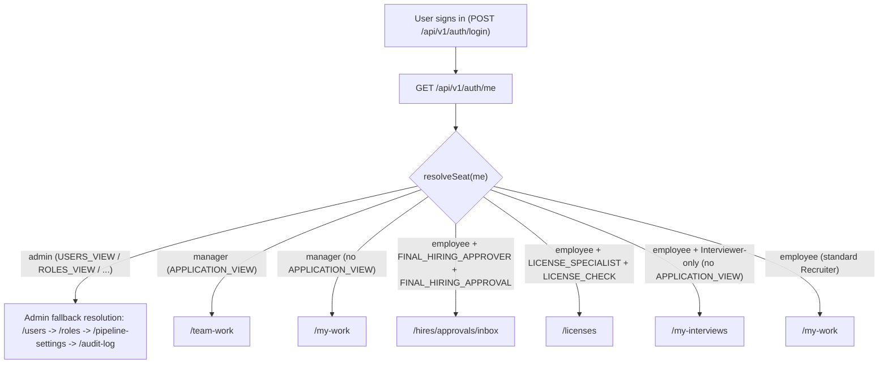

# 01 — Workspaces, Roles & RBAC

RecruitFlow separates **workspace presentation (`Seat`)**, **dedicated permission queues (`specialHome`)**, **granular backend authorization (`@RequirePermissions`)**, and **row-level organizational & reporting-line isolation**. UI hiding is never treated as security: every route and API endpoint enforces server-side checks.

---

## 1. The Three Workspace Seats (`employee`, `manager`, `admin`)

Seat resolution lives in [apps/web/src/v2/seat.ts](../../apps/web/src/v2/seat.ts) and is driven server-first by `GET /api/v1/auth/me` (`me.seat` from B10 rollout config, falling back to `PROVISIONAL_ROLE_SEATS`):

| Seat | UI Label | Default Home (`SEAT_HOME`) | Typical Roles |
|---|---|---|---|
| `employee` | **Employee** | `/my-work` | `RECRUITER`, `ROLE_001`, `EMPLOYEE`, `VIEWER`, `HR_OPERATIONS`, plus permission-scoped `INTERVIEWER`, `LICENSE_SPECIALIST`, `FINAL_HIRING_APPROVER` |
| `manager` | **Manager** | `/team-work` | `HIRING_MANAGER`, `HR_MANAGER`, `TALENT_MANAGER`, `TEAM_LEADER`, `TEAM_LEAD`, `RECRUITMENT_LEAD`, `LEAD_RECRUITER`, `OFFER_APPROVER` |
| `admin` | **Admin** | `/users` | `ADMINISTRATOR`, `SYSADMINISTRATOR` |

- **Workspace Switching (`availableWorkspaceSeats`):** An Administrator sees all three workspaces (`employee`, `manager`, `admin`) in the header account menu; multi-role users see `employee` plus any seat mapped by their assigned role codes. The seeded `demo.multi@recruitflow.local` user (`ADMINISTRATOR` + `HIRING_MANAGER` + `RECRUITER`) sees all three seats and is the demo account for multi-role behavior.
- **V2 Seat Rollout Flags (B10):** Controlled via organization integration config (`Integration.name = 'ROLLOUT_SEATS'`, `configJson.v2Seats`) or `RF_V2_SEATS` env var (defaults to `employee`).

---

## 2. Special Reviewer & Specialist Queues (`apps/web/src/v2/destinations.ts`)

| Persona / Condition | Landing Route (`specialHome` / `authorizedLanding`) | Allowed Scope | Blocked Surfaces |
|---|---|---|---|
| **Recruiter (`RECRUITER` only)** | `/my-work` | Open jobs, candidates, CV bank, Skill Matching, offers, hires, joinings, applications, reports | Requisitions (`/vacancy-requests` blocked server-side with `403` and client-side per `isRecruiterOnly`), `/team-work`, Admin pages |
| **Interviewer-only (`interviewerOnly`)** | `/my-interviews` | `/my-work`, `/my-interviews`, `/profile`, `/notifications`, `/search` | Cannot browse `/candidates`, `/vacancies`, `/applications/:id`, or `/offers` |
| **License Specialist** | `/licenses` | `/licenses` (`LICENSE_CHECK` / `APPLICATION_VIEW`), `/applications/:id` pre-hire checks drawer, `/hires/:id` | Does not gain offer compensation visibility without `OFFER_PAY_VIEW` |
| **Final Hiring Approver** | `/hires/approvals/inbox` | `/hires/approvals/inbox` (`FINAL_HIRING_APPROVAL`), `/hires/:id`, `/applications/:id` | Dedicated approval queue isolation |
| **Admin (Scoped Permissions)** | First permitted admin page (`/users`, `/roles`, `/pipeline-settings`, `/audit-log`) | User directory & embedded Reporting Tree (`/users?view=tree`), roles, master data, templates, integrations, audit logs | **Cannot** change job status (`ADMIN_CANNOT_CHANGE_JOB_STATUS`) or assign/reassign job/file owners (`ADMIN_CANNOT_REASSIGN` / `REASSIGN_ADMIN_FORBIDDEN`) |

---

## 3. Server-Side Security, RBAC & Privacy Boundaries

### Authentication & Sessions (`apps/api/src/auth/`)
- **Cookies:** `access_token` (scoped to `Path=/api/v1`, `HttpOnly`, `SameSite=Lax`, default TTL `15m`) and `refresh_token` (scoped to `Path=/api/v1/auth/refresh`, `HttpOnly`, `SameSite=Lax`, default TTL `7d`). `POST /api/v1/auth/logout` clears both cookies using identical path/attribute options (`Max-Age=0`) and invalidates the session.
- **Account Protection:** Failed logins track both per-account (`AUTH_MAX_ATTEMPTS=5`) and per-IP (`AUTH_IP_MAX_ATTEMPTS=25`) counters in `AuthRateLimit` over `AUTH_WINDOW_DURATION=300s` with `AUTH_LOCKOUT_DURATION=900s`.
- **Anti-Enumeration:** Password reset requests and email verification requests return `{ accepted: true }` (`HTTP 200`) identically for known and unknown emails. Outbox auth tokens are AES-256-GCM encrypted (`EMAIL_OUTBOX_ENCRYPTION_KEY`).

### Strong Passwords & Forced First-Login Change (`packages/validation/src/password-policy.ts`)
- **Strong password policy (all password sets/resets):** Minimum **10** characters, maximum 128, at least one uppercase letter, one lowercase letter, one digit, and one special (non-alphanumeric) character; the password must not contain the local part of the user's email address (when that local part is at least 3 characters). Evaluated by `evaluateStrongPassword`; violations fail with `WEAK_PASSWORD` (`HTTP 400`), never as a generic validation error.
- **Self-service change:** `POST /api/v1/me/password` (`MeController`, `ChangePasswordDto`: `currentPassword` + `newPassword`) clears the forced-change flag and stamps `User.passwordChangedAt`.
- **Admin reset:** `POST /api/v1/users/:id/password` (`UsersController.adminChangePassword`, admin seat + `USERS_MANAGE`, tenant-scoped, audited as `USER_PASSWORD_CHANGE`) sets a new password and, unless `requireChangeOnNextLogin: false` is passed explicitly, forces the user to change it at next login (`mustChangePassword: true`, `passwordChangedAt` stamped at reset time).
- **Forced-change flow (`User.mustChangePassword`, `User.passwordChangedAt`):** `POST /api/v1/auth/login` and `GET /api/v1/auth/me` expose `mustChangePassword`; while it is `true` the JWT guard restricts the user to the password-change path and the app routes them to `/change-password`. Creating a user (`POST /api/v1/users`, see 04 §2) defaults `mustChangePassword` to `true` with `passwordChangedAt: null`, so every new account must set its own password at first login. The seeded first-login test account is `new.employee@recruitflow.local` (`RECRUITER`, reports to `demo.multi@recruitflow.local`, `mustChangePassword: true`).

### Multi-Tenant Isolation & Safe Error Envelopes
- **Tenant Extraction:** Every query scopes strictly by the authenticated caller's session `organizationId`. Global `ValidationPipe({ transform: true, whitelist: true, forbidNonWhitelisted: true })` rejects injected `organizationId` / `orgId` fields with `HTTP 400 VALIDATION_ERROR`.
- **Cross-Tenant Reads/Writes:** Accessing a resource belonging to another organization returns safe `HTTP 404 NOT_FOUND` (`"Resource not found"` — zero existence leakage, zero SQL/Prisma stack traces).
- **Direct Manager / Team Hierarchy:** Manager team endpoints (`/team/work`, `/results/team`, `/vacancy-requests`, offer decisions, file reassignments) resolve direct reports recursively/by `User.managerId` reporting tree (`Users → Visual Org Chart & Reporting Tree`).

### Compensation & Salary Privacy (`apps/api/src/common/access/pay-visibility.ts`)
RecruitFlow enforces **two completely independent** salary permissions:
1. **`OFFER_PAY_VIEW`:** Controls visibility of offer `monthlyPackage`, `annualFixed`, `OfferComponent.amount/currency/frequency`, grade-band min/max pay figures, and pay details in offer/band error envelopes. Seeded `ADMINISTRATOR` and `RECRUITER` roles **do not** hold `OFFER_PAY_VIEW` (when missing, pay keys are omitted rather than returned as `null`; sending pay requires `OFFER_PAY_VIEW` or returns `403 OFFER_PAY_VIEW_REQUIRED`).
2. **`VIEW_CURRENT_SALARY`:** Controls candidate current/expected compensation captured during screening. Having `VIEW_CURRENT_SALARY` alone (e.g., an admin) **never** reveals offer pay (`OFFER_PAY_VIEW`).
3. **Frontend Defense-in-Depth:** `stripPay` ([apps/web/src/v2/api/paySafety.ts](../../apps/web/src/v2/api/paySafety.ts)) ensures UI components for non-privileged roles never accidentally transmit salary fields in offer drafts (`components: []`) or screening saves.
