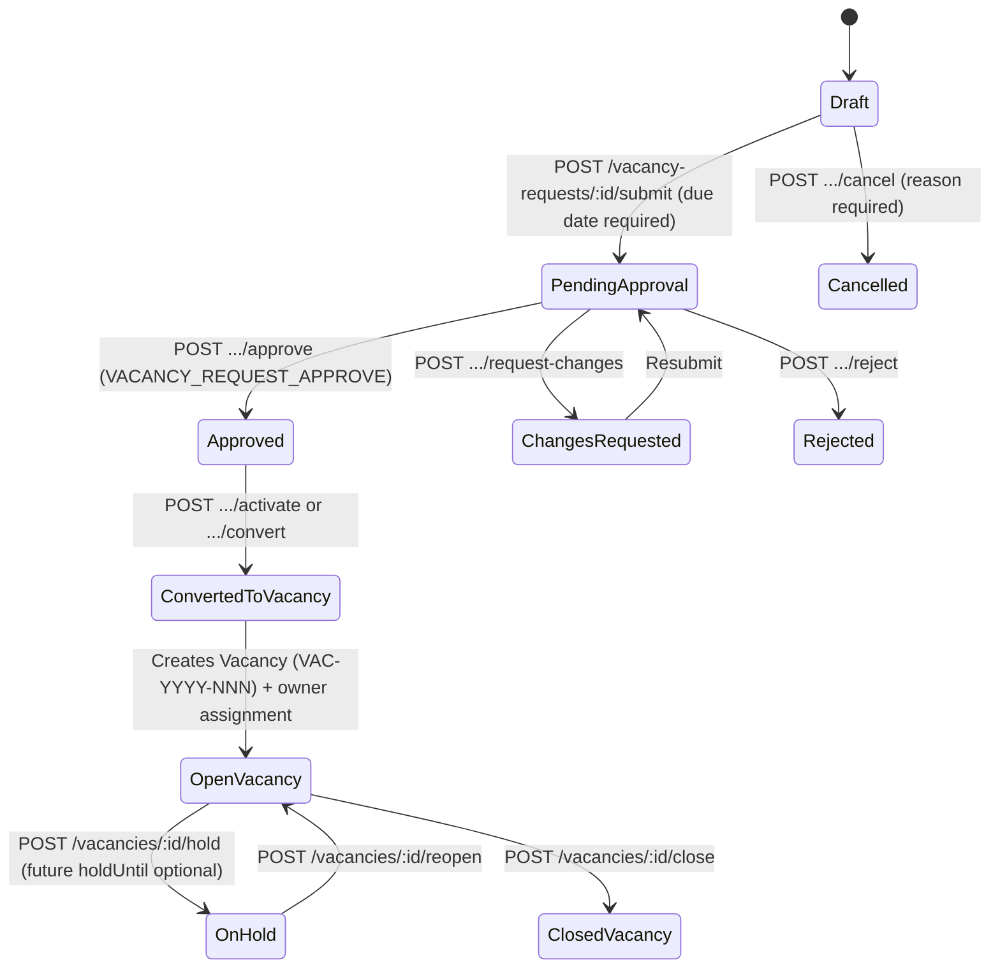
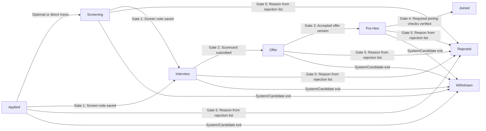

# 02 — End-to-End Hiring Workflows & Hard Gates

Every hiring lifecycle in RecruitFlow follows server-governed state machines backed by optimistic concurrency (`version`), audit logging (`AuditLog`), and non-bypassable API transition gates.

---

## 1. Requisition-to-Vacancy Lifecycle (`VacancyRequest` → `Vacancy`)

Managed by Hiring Managers / Approvers via `/vacancy-requests`, `/approvals`, `/vacancies/:id`, and `VacancyRequestsController` / `VacanciesController`:

### Key Requisition & Vacancy Invariants
- **Due Date Required (`DUE_DATE_REQUIRED`):** Drafts cannot be submitted or activated without `targetFillDate`.
- **Target Adjustments (`PATCH /vacancy-requests/:id/target`):** Seats cannot be cut below already joined hires (`SEATS_BELOW_JOINED`); live target edits require an explicit `reason`.
- **Job Owner Integrity:** Activating/converting a requisition requires an eligible assignee (`ASSIGNEE_REQUIRED`, `ASSIGNEE_NOT_ELIGIBLE`). Administrators **cannot** change job status (`ADMIN_CANNOT_CHANGE_JOB_STATUS`) or reassign owners (`ADMIN_CANNOT_REASSIGN`).
- **No Budget Leakage:** Budget figures entered on requisitions stay hidden from employee/recruiter vacancy views (`open jobs` shows target seats and site only).

---

## 2. Canonical 8-Stage Application Pipeline & Hard Gates

Defined in [database/prisma/seed.cjs](../../database/prisma/seed.cjs) and enforced server-side in [apps/api/src/applications/application-gates.ts](../../apps/api/src/applications/application-gates.ts). Even when organizations customize stage labels in `/pipeline-settings`, the 5 server-side `GATE_*` checks remain authoritative (`HTTP 409 CONFLICT` returning `{ code, gate, message, missing[] }`):

| Gate # | Transition | Server Precondition (`application-gates.ts`) | HTTP 409 Code |
|---|---|---|---|
| **Gate 1** | `Applied` / `Screening` → `Interview` | At least one `ScreeningLog` exists with non-empty `notes` (private `ScreeningDraft` auto-saves without triggering a move until submitted). | `GATE_SCREEN_NOTE_MISSING` |
| **Gate 2** | `Interview` → `Offer` | At least one `InterviewScorecard` has `status = 'Submitted'` on a non-cancelled interview. | `GATE_SCORECARD_NOT_SUBMITTED` |
| **Gate 3** | `Offer` → `Pre-Hire` | An `OfferVersion` linked to the application's `Offer` has `status = 'Accepted'`. | `GATE_OFFER_NOT_ACCEPTED` |
| **Gate 4** | `Pre-Hire` → `Joined` | `assertCanMarkJoined`: all required pre-hire joining checks (`ID`, `CONTRACT`, `SCFHS_LICENCE` per job snapshot) are `verified = true` + valid non-expired licence + explicit actual joining date (`POST /hiring/:id/joining`). | `GATE_JOINING_CHECKS_INCOMPLETE` |
| **Gate 5** | Any open stage → `Rejected` | Reason must match an active org `rejection-reasons` catalog item or system reasons (`Declined offer`, `Requisition cancelled`, `Withdrawn by candidate`). Choosing `Other` requires a note `>= 3` chars (`REASON_REQUIRED`). | `GATE_REJECT_REASON_REQUIRED` |

---

## 3. Stage Execution Details

### Intake, CV Bank, Deduplication & ATS Matching
- **CV Intake Engine (`CvIntakeEngineDrawer` & `ImportCvsDrawer`):** Supports client/server PDF & Word CV extraction (`/api/v1/resume/parse`, up to `10 MB` per file), clinical acronym normalization via [skillFormat.ts](../../apps/web/src/v2/drawers/skillFormat.ts) (`ECG`, `ICU`, `BLS`, `ACLS`, etc.), live duplicate checks (`POST /api/v1/candidates/duplicate-check` normalized email & phone with default country code `966`), and immediate job-fit evaluation before creating candidates or adding to a vacancy.
- **Skill Matching (`/sourcing-match`):** Server-driven suggestions (`GET /api/v1/vacancies/:id/suggestions`) ranked across `Best`, `Good`, `Potential`, and `Low` match tiers using skill evidence (`CandidateSkillEvidence`) rather than ungrounded local scoring. Compare view (`/candidates/compare`) compares **2–4** selected candidates (`COMPARE_COUNT`).

### Interviews & Scorecards
- **Room Allowlist:** Video interview links (`locationUrl`) must use `https://` and match `INTERVIEW_ROOM_HOSTS` (Teams, Zoom, Google Meet, Webex); otherwise rejected with `ROOM_URL_HOST_NOT_ALLOWED`.
- **Self-Scheduling (`/schedule/:token`):** Signed HMAC tokens (`SELF_SCHEDULE_SECRET`) allow candidates to pick from available interviewer slots cleanly without exposing internal staff calendars.
- **Scorecards:** Submitted scorecards are immutable except through audited revision requests requiring a reason (`POST /api/v1/interviews/:id/scorecard/revisions`, `REVISION_REASON_REQUIRED`).

### Offers, Grade Bands & Pre-Hire / Joining
- **Offer Lifecycle:** `Draft` → `Pending Approval` → `Approved` → `Sent` → `Accepted` / `Declined` / `Withdrawn` / `Expired`.
- **Grade Band Enforcement (`B7`):** When sending an offer decision with compensation (`POST /api/v1/offers/:id/versions/:versionId/decision`), base pay must match the configured org/branch `GradeBand` currency (`OFFER_BASE_CURRENCY_MIXED`) and range (`OFFER_PAY_OUTSIDE_BAND`). Sending an offer requires selecting a default/active WhatsApp or communication template (`OFFER_SEND_REQUIRES_TEMPLATE`).
- **Pre-Hire & Final Approval (`HiringCase`):** Final Hiring Approvers review `/hires/approvals/inbox` (`FINAL_HIRING_APPROVAL` + mandatory `comment`); License Specialists verify `SCFHS_LICENCE` checks and expiry dates (`LICENCE_EXPIRY_REQUIRED` / `LICENCE_EXPIRED`) on `/licenses` before joining can be recorded.

### Reassignment, Follow-Up Ownership & Reopening
- **Reassignment (`POST /api/v1/files/reassign` & `FileReassignment`):** Strictly scoped to direct managers (`REASSIGN_NOT_MANAGER`, `REASSIGN_SCOPE`, `REASSIGN_TARGET_NOT_IN_TEAM`) and closed-file protection (`REASSIGN_FILE_CLOSED`). Admins are explicitly blocked (`REASSIGN_ADMIN_FORBIDDEN`) unless using audited `/admin/overrides`.
- **Reopening Rejected Files:** Only the file owner or their direct manager can reopen (`Applied` / `Screening` / `Interview` in `REOPEN_TARGETS`), and only with an explicit audit reason (`REOPEN_REASON_REQUIRED`).
