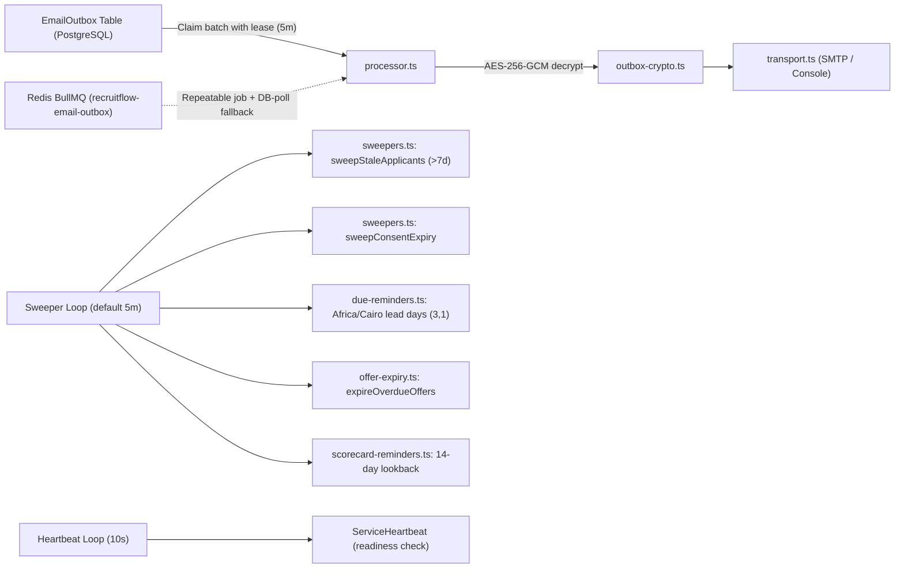

# 05 — Database Schema, Seed & Background Workers

PostgreSQL (`database/prisma/schema.prisma`) is the system of record across **60 Prisma models** (`@recruitflow/database`), paired with `apps/worker` (`9` modules) handling encrypted async email delivery and 5 concurrent SLA/compliance sweepers.

---

## 1. All 60 Prisma Models by Domain (`database/prisma/schema.prisma`)

| Domain Group | Count | Exact Model Names |
|---|---:|---|
| **Organization & Master Data** | 5 | `Organization`, `Branch`, `Position`, `MasterDataValue`, `GradeBand` |
| **Identity, Auth & RBAC** | 7 | `User`, `Role`, `Permission`, `UserRole`, `RolePermission`, `AuthToken`, `AuthRateLimit` |
| **Vacancies & Requisitions** | 5 | `VacancyRequest`, `VacancyRequestApproval`, `Vacancy`, `VacancyAssignment`, `VacancyStatusHistory` |
| **Candidates, Documents & Skills** | 7 | `Candidate`, `CandidateDocument`, `VacancyDocument`, `TalentPool`, `TalentPoolCandidate`, `CandidateSkill`, `CandidateSkillEvidence` |
| **Pipeline, Screening & Interviews** | 8 | `Application`, `ApplicationStatusHistory`, `ApplicationNote`, `ScreeningLog`, `ScreeningDraft`, `Interview`, `InterviewAttendee`, `InterviewScorecard`, `InterviewScorecardRating` *(9 total — see split note below)* |
| **Offers & Hiring / Joining** | 9 | `Offer`, `OfferVersion`, `OfferComponent`, `OfferApproval`, `OfferVersionDecision`, `HiringCase`, `ComplianceRequirement`, `HiringCaseApproval`, `JoiningCheck` |
| **Ownership, Targets & Results** | 4 | `FileReassignment`, `RecruiterTarget`, `EmployeeActivityTarget`, `EmployeeActivityTargetRevision` |
| **Import, Templates, Notifications & Tasks** | 7 | `CandidateImportJob`, `CandidateImportRow`, `EmailTemplate`, `WhatsAppTemplate`, `PipelineTemplate`, `PipelineStage`, `Notification`, `Task`, `DueDateReminder` *(9 total)* |
| **Integrations, Outbox & Audit** | 5 | `Integration`, `ServiceHeartbeat`, `EmailOutbox`, `AuditLog`, `CodeSequence` |

Exact alphabetical check confirms **60 `model` declarations** in `database/prisma/schema.prisma`:
`Application`, `ApplicationNote`, `ApplicationStatusHistory`, `AuditLog`, `AuthRateLimit`, `AuthToken`, `Branch`, `Candidate`, `CandidateDocument`, `CandidateImportJob`, `CandidateImportRow`, `CandidateSkill`, `CandidateSkillEvidence`, `CodeSequence`, `ComplianceRequirement`, `DueDateReminder`, `EmailOutbox`, `EmailTemplate`, `EmployeeActivityTarget`, `EmployeeActivityTargetRevision`, `FileReassignment`, `GradeBand`, `HiringCase`, `HiringCaseApproval`, `Integration`, `Interview`, `InterviewAttendee`, `InterviewScorecard`, `InterviewScorecardRating`, `JoiningCheck`, `MasterDataValue`, `Notification`, `Offer`, `OfferApproval`, `OfferComponent`, `OfferVersion`, `OfferVersionDecision`, `Organization`, `Permission`, `PipelineStage`, `PipelineTemplate`, `Position`, `RecruiterTarget`, `Role`, `RolePermission`, `ScreeningDraft`, `ScreeningLog`, `ServiceHeartbeat`, `TalentPool`, `TalentPoolCandidate`, `Task`, `User`, `UserRole`, `Vacancy`, `VacancyAssignment`, `VacancyDocument`, `VacancyRequest`, `VacancyRequestApproval`, `VacancyStatusHistory`, `WhatsAppTemplate`.

---

## 2. Database Seed (`database/prisma/seed.cjs`)

- **Canonical Default Pipeline (`seedDefaultPipeline`):** Ensures every organization has one active default `PipelineTemplate` containing all 8 canonical stages in order (`Applied`, `Screening`, `Interview`, `Offer`, `Pre-Hire`, `Joined` with `isHiredStage: true`, plus `Rejected` & `Withdrawn` exit stages) and automatically heals existing empty templates.
- **Seeded Personas (Local Dev / Staging Only):** Seeds **Org A** (`RecruitFlow Demo Organization`, e.g., Admin `ahmed.mahmoud@recruitflow.local` & `admin@sgh.com`, Recruiter `sarah.ahmed@recruitflow.local`, Hiring Manager `hassan.ali@recruitflow.local`) and **Org B** (`Acme Global Healthcare`, `tarek.kamal@acme-health.local`) for RBAC & tenant-isolation testing. Never deploy seed accounts directly to production.

---

## 3. Background Worker Runtime (`apps/worker/src/`)

Entrypoint [apps/worker/src/main.ts](../../apps/worker/src/main.ts) orchestrates `9` worker modules across three concurrent loops:

1. **Email Outbox Processor (`processor.ts`, `outbox-crypto.ts`, `transport.ts`, `templates.ts`):**
   - Uses BullMQ (`recruitflow-email-outbox`) when Redis is connected alongside a resilient PostgreSQL polling fallback (`WORKER_POLL_INTERVAL_MS=2000`, `WORKER_BATCH_SIZE=20`, reclaim lease `DEFAULT_PROCESSING_LEASE_MS = 300_000ms`), exponential backoff (`5s` base to `15m` cap), and AES-256-GCM token decryption (`assertOutboxEncryptionKey`).
2. **Sweeper Loop (`SWEEPER_INTERVAL_MS` default `5 min`, staggered `30s` at startup):**
   - `sweepStaleApplicants`: Flags/nudges open applications untouched for `> 7` days (`STALE_THRESHOLD_DAYS = 7`).
   - `sweepConsentExpiry`: Audits/updates expired candidate consent records in `TalentPoolCandidate`.
   - `sweepDueDateReminders`: Fires once per entity/kind/day from `DUE_REMINDER_HOUR_CAIRO` (default `8:00 Africa/Cairo`) using configured `DUE_REMINDER_LEAD_DAYS` (`3,1`).
   - `expireOverdueOffers`: Expires overdue sent offers cleanly when enabled (`OFFER_AUTO_EXPIRE_ENABLED`).
   - `sweepScorecardReminders`: Scans interviews ended within the past `14` days (`LOOKBACK_DAYS = 14`) missing submitted scorecards.
3. **Worker Readiness Heartbeat (`ServiceHeartbeat`):** Writes live status every `10s` (`WORKER_HEARTBEAT_INTERVAL_MS=10000`, readiness threshold `WORKER_HEARTBEAT_MAX_AGE_MS=60000`).
