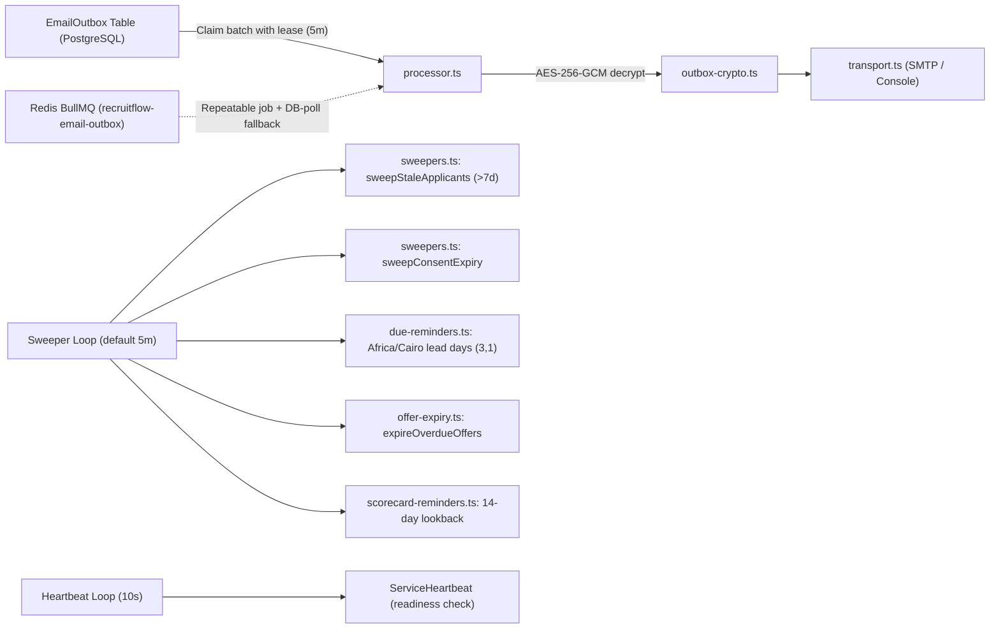

# 05 — Database Schema, Seed & Background Workers

PostgreSQL (`database/prisma/schema.prisma`) is the system of record across **60 Prisma models** (`@recruitflow/database`), paired with `apps/worker` (`9` modules) handling encrypted async email delivery and 5 concurrent SLA/compliance sweepers.

---

## 1. All 60 Prisma Models by Domain (`database/prisma/schema.prisma`)

| Domain Group | Count | Exact Model Names |
|---|---:|---|
| **Organization & Master Data** | 5 | `Organization`, `Branch`, `Position`, `MasterDataValue`, `GradeBand` |
| **Identity, Auth & RBAC** | 7 | `User`, `Role`, `Permission`, `UserRole`, `RolePermission`, `AuthToken`, `AuthRateLimit` |
| **Vacancies & Requisitions** | 5 | `VacancyRequest`, `VacancyRequestApproval`, `Vacancy`, `VacancyAssignment`, `VacancyStatusHistory` |
| **Candidates, Documents & Skills** | 7 | `Candidate`, `CandidateDocument`, `VacancyDocument`, `TalentPool`, `TalentPoolCandidate`, `CandidateSkill`, `CandidateSkillEvidence` |
| **Pipeline, Screening & Interviews** | 8 | `Application`, `ApplicationStatusHistory`, `ApplicationNote`, `ScreeningLog`, `ScreeningDraft`, `Interview`, `InterviewAttendee`, `InterviewScorecard`, `InterviewScorecardRating` *(9 total — see split note below)* |
| **Offers & Hiring / Joining** | 9 | `Offer`, `OfferVersion`, `OfferComponent`, `OfferApproval`, `OfferVersionDecision`, `HiringCase`, `ComplianceRequirement`, `HiringCaseApproval`, `JoiningCheck` |
| **Ownership, Targets & Results** | 4 | `FileReassignment`, `RecruiterTarget`, `EmployeeActivityTarget`, `EmployeeActivityTargetRevision` |
| **Import, Templates, Notifications & Tasks** | 7 | `CandidateImportJob`, `CandidateImportRow`, `EmailTemplate`, `WhatsAppTemplate`, `PipelineTemplate`, `PipelineStage`, `Notification`, `Task`, `DueDateReminder` *(9 total)* |
| **Integrations, Outbox & Audit** | 5 | `Integration`, `ServiceHeartbeat`, `EmailOutbox`, `AuditLog`, `CodeSequence` |

Exact alphabetical check confirms **60 `model` declarations** in `database/prisma/schema.prisma`:
`Application`, `ApplicationNote`, `ApplicationStatusHistory`, `AuditLog`, `AuthRateLimit`, `AuthToken`, `Branch`, `Candidate`, `CandidateDocument`, `CandidateImportJob`, `CandidateImportRow`, `CandidateSkill`, `CandidateSkillEvidence`, `CodeSequence`, `ComplianceRequirement`, `DueDateReminder`, `EmailOutbox`, `EmailTemplate`, `EmployeeActivityTarget`, `EmployeeActivityTargetRevision`, `FileReassignment`, `GradeBand`, `HiringCase`, `HiringCaseApproval`, `Integration`, `Interview`, `InterviewAttendee`, `InterviewScorecard`, `InterviewScorecardRating`, `JoiningCheck`, `MasterDataValue`, `Notification`, `Offer`, `OfferApproval`, `OfferComponent`, `OfferVersion`, `OfferVersionDecision`, `Organization`, `Permission`, `PipelineStage`, `PipelineTemplate`, `Position`, `RecruiterTarget`, `Role`, `RolePermission`, `ScreeningDraft`, `ScreeningLog`, `ServiceHeartbeat`, `TalentPool`, `TalentPoolCandidate`, `Task`, `User`, `UserRole`, `Vacancy`, `VacancyAssignment`, `VacancyDocument`, `VacancyRequest`, `VacancyRequestApproval`, `VacancyStatusHistory`, `WhatsAppTemplate`.

---

## 2. Database Seed (`database/prisma/seed.cjs`)

- **Canonical Default Pipeline (`seedDefaultPipeline`):** Ensures every organization has one active default `PipelineTemplate` containing all 8 canonical stages in order (`Applied`, `Screening`, `Interview`, `Offer`, `Pre-Hire`, `Joined` with `isHiredStage: true`, plus `Rejected` & `Withdrawn` exit stages) and automatically heals existing empty templates.
- **Seeded Personas (Local Dev / Staging Only):** Run with `pnpm db:seed` (`database: prisma:seed` → `node prisma/seed.cjs`), which also runs the demo fixtures in `database/prisma/demo-fixtures.cjs` — there is no separate `seed:demo` script; `db:seed` is the demo-seed command. All demo users share the single standard local-dev seed password hash. Seeds **Org A** (`RecruitFlow Demo Organization`) and **Org B** (`Acme Global Healthcare`, `tarek.kamal@acme-health.local`) for RBAC & tenant-isolation testing. Never deploy seed accounts directly to production.
- **Org A hierarchy (3 levels, visible in `/users?view=tree`):** Executive — `hassan.ali@recruitflow.local` (`HIRING_MANAGER`, top level) and `admin@sgh.com` (`ADMINISTRATOR`, top level); Team A Manager — `mona.manager@recruitflow.local` (`TALENT_MANAGER`, reports to Hassan) → `sarah.ahmed@recruitflow.local`, `sindu@recruitflow.local`, `zenah@recruitflow.local` (`RECRUITER`) and `omar.nasser@recruitflow.local` (`LICENSE_SPECIALIST`); Team B Manager — `omar.hassan@recruitflow.local` (`HIRING_MANAGER`, reports to Hassan) → `lady@recruitflow.local` and `karim.recruiter@recruitflow.local` (`RECRUITER`) and `dr.karim.interviewer@recruitflow.local` (`INTERVIEWER`); Final Hiring Approver — `aya.mostafa@recruitflow.local` (`FINAL_HIRING_APPROVER`, top level). `ahmed.mahmoud@recruitflow.local` (`ADMINISTRATOR`, HR Director) is the second seeded admin.
- **3-role demo user:** `demo.multi@recruitflow.local` ("Demo Multi-Role Lead") holds `ADMINISTRATOR` + `HIRING_MANAGER` + `RECRUITER` on one account (via `UserRole`), reports to Hassan, owns open vacancy `VAC-2026-011` (Specialist Obs/Gyn) with applications `APP-100208` (Applied) and `APP-100209` (Screening), and manages `new.employee@recruitflow.local`.
- **Forced first-login test user:** `new.employee@recruitflow.local` (`RECRUITER`, reports to `demo.multi@recruitflow.local`) is seeded with `User.mustChangePassword = true` and `passwordChangedAt = null`, so its first login is forced to `/change-password`. `User` also carries `mustChangePassword Boolean @default(false)` and `passwordChangedAt DateTime?` (migration `20261123180600_user_must_change_password`); new users created via the API default to `mustChangePassword: true` (see 01 §3, 04 §2).
- **Full-workflow dummy coverage (demo fixtures):** Requisitions in every status — `Draft` (`VR-2026-010`), `Pending Approval` (`VR-2026-007`, `VR-2026-011`), `Changes Requested` (`VR-2026-012`), `Approved` (`VR-2026-013`), `Converted to Vacancy` (all requisitions with a vacancy); vacancies `Open`, `On Hold` (`VAC-2026-009`), `Closed` (`VAC-2026-010`), `Filled` / `Partially Filled`; applications in all 8 pipeline stages including `Rejected` (`APP-100206`, reason `Did not pass screening`) and `Withdrawn` (`APP-100207`); a Screening draft (`APP-100191`) plus submitted screening logs; Scheduled (pending) interviews plus Submitted and Draft scorecards; offers in `Draft` / `Pending Approval` / `Changes Requested` / `Approved` (`OFF-2026-0150`) / `Sent` / `Accepted` with AED `GradeBand` rows (`G5`/`G6`/`G7` per branch); pre-hire hiring cases with SCFHS license checks (`Pending` on Mozna, `Verified` on Tasabeeh) and a pending `FINAL_HIRING_APPROVER` final approval; `Joined` cases; current-month `RecruiterTarget` rows (month computed dynamically in `Africa/Cairo`, never hard-coded) alongside the `EmployeeActivityTarget` rows in `seed.cjs`; seeded `Task` rows (`ApprovalReview`, `ComplianceCheck`, `OfferReview`) and `Notification` rows including a `PasswordChangeRequired` notice for the new starter; candidates with clinical/technical skills and CV Bank `CandidateDocument` rows. Requisition status strings are the spaced display values (`Pending Approval`, `Changes Requested`, `Converted to Vacancy`) — there is no `PendingApproval` / `Converted` code.

---

## 3. Background Worker Runtime (`apps/worker/src/`)

Entrypoint [apps/worker/src/main.ts](../../apps/worker/src/main.ts) orchestrates `9` worker modules across three concurrent loops:

1. **Email Outbox Processor (`processor.ts`, `outbox-crypto.ts`, `transport.ts`, `templates.ts`):**
   - Uses BullMQ (`recruitflow-email-outbox`) when Redis is connected alongside a resilient PostgreSQL polling fallback (`WORKER_POLL_INTERVAL_MS=2000`, `WORKER_BATCH_SIZE=20`, reclaim lease `DEFAULT_PROCESSING_LEASE_MS = 300_000ms`), exponential backoff (`5s` base to `15m` cap), and AES-256-GCM token decryption (`assertOutboxEncryptionKey`).
2. **Sweeper Loop (`SWEEPER_INTERVAL_MS` default `5 min`, staggered `30s` at startup):**
   - `sweepStaleApplicants`: Flags/nudges open applications untouched for `> 7` days (`STALE_THRESHOLD_DAYS = 7`).
   - `sweepConsentExpiry`: Audits/updates expired candidate consent records in `TalentPoolCandidate`.
   - `sweepDueDateReminders`: Fires once per entity/kind/day from `DUE_REMINDER_HOUR_CAIRO` (default `8:00 Africa/Cairo`) using configured `DUE_REMINDER_LEAD_DAYS` (`3,1`).
   - `expireOverdueOffers`: Expires overdue sent offers cleanly when enabled (`OFFER_AUTO_EXPIRE_ENABLED`).
   - `sweepScorecardReminders`: Scans interviews ended within the past `14` days (`LOOKBACK_DAYS = 14`) missing submitted scorecards.
3. **Worker Readiness Heartbeat (`ServiceHeartbeat`):** Writes live status every `10s` (`WORKER_HEARTBEAT_INTERVAL_MS=10000`, readiness threshold `WORKER_HEARTBEAT_MAX_AGE_MS=60000`).
