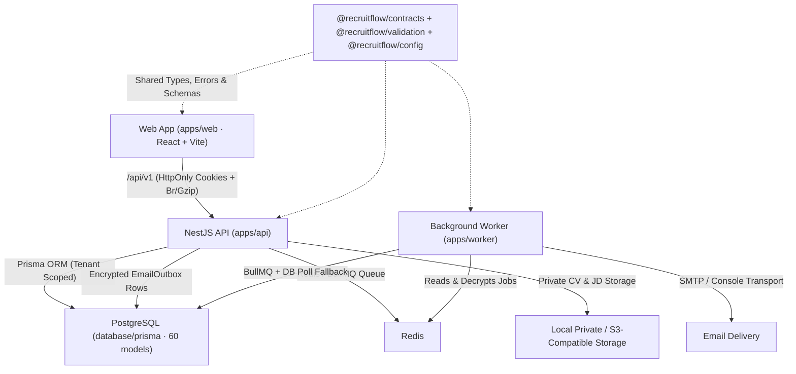

# RecruitFlow Full System Guide (`v0.2.0`)

Canonical, source-verified engineering and operations guide for **RecruitFlow** — the multi-tenant recruitment and clinical hiring workflow platform built for Saudi German Health. Every route, controller prefix, Prisma model, error code, worker sweeper, and governance rule in this guide maps directly to the live `v0.2.0` codebase.

## Documentation Map

| Guide | Audience | Coverage |
|---|---|---|
| [01 — Workspaces, Roles & RBAC](01-workspaces-roles-and-rbac.md) | All teams, Support, AI Copilot | 3 workspace seats (`employee`, `manager`, `admin`), special approver/license/interviewer homes, server RBAC, tenant isolation, and pay-privacy rules |
| [02 — End-to-End Hiring Workflows & Gates](02-end-to-end-hiring-workflows-and-gates.md) | Recruiters, Managers, Approvers, QA | Requisition-to-Vacancy conversion, canonical 8-stage pipeline, 5 hard API stage gates (`GATE_*`), grade-band approval, ATS compare, reassignment & reopen rules |
| [03 — Frontend Routes, Pages & Drawers](03-frontend-routes-pages-and-drawers.md) | Frontend Devs, UI/UX, Support | All 64 `SCREEN_ROUTES`, V2 pages, 16 workflow drawers (`CvIntakeEngineDrawer`, `ImportCvsDrawer`, etc.), SWR view cache, 15-row pagination, design tokens, accessibility |
| [04 — Backend API Modules & Contracts](04-backend-api-modules-and-contracts.md) | Backend Devs, API Consumers | All 37 NestJS modules & 49 controller declarations across 46 controller files (`/api/v1`), compression, security headers, CV storage hardening, Zod schemas, `errorCodes` |
| [05 — Database Schema & Workers](05-database-schema-and-workers.md) | DBAs, Backend Devs, SRE | All 60 Prisma `model` definitions by domain, `seed.cjs` healing & personas, BullMQ email outbox (AES-256-GCM), and all 5 background sweepers |
| [06 — Operations, CI & Release](06-operations-ci-and-release.md) | DevOps, Release Managers | Environment configuration (`@recruitflow/config`), Docker / Hostinger / Vercel deployment, pnpm supply-chain overrides, CI workflows & test gates |
| [AI Assistant Guide & Knowledge Pack](ai-assistant/SYSTEM_PROMPT.md) | AI Engineers, Support Ops | Drop-in system prompt, retrieval blueprint, structured JSONL RAG chunks, persona FAQs & evaluation benchmarks |

---

## Monorepo Architecture

```text
apps/
  web/        React + Vite SPA (V2 UI under [data-ui='v2'], SGH Light/Dark themes)
  api/        NestJS REST API (/api/v1 global prefix, Express + cookie-parser + compression)
  worker/     BullMQ + PostgreSQL-fallback outbox mailer and background SLA/compliance sweepers
database/
  prisma/     schema.prisma (60 models), 66+ migrations, seed.cjs
  generated/  Generated Prisma Client consumed via @recruitflow/database
packages/
  config/         Zod runtime environment schema (packages/config/src/index.ts)
  contracts/      Shared TypeScript interfaces, HTTP envelopes & ERROR_CODES
  validation/     Shared Zod DTO schemas, skill taxonomy, matching, evidence ranker & CV parser
  design-system/  Design system documentation & token contract (backed by apps/web/src/styles/tokens.css)
```



---

## Canonical Domain Vocabulary

Per [GLOSSARY.md](../../GLOSSARY.md), every user guide, UI surface, and AI Assistant must use exact domain terms:

| Canonical Term | Exact Definition | Avoid |
|---|---|---|
| **File** (`Application`) | One candidate's application to one open job; stays in its current stage until its required next step is satisfied. | "Ticket", "Card" as a synonym for application record |
| **Next action** | The single step an application file needs from its current owner/reviewer before the stage can advance. | "Recommended action" |
| **Seat** | One of the three workspace shells (`employee`, `manager`, `admin`) rendered by `V2Shell` / `AppShellV2`. | Treating `Interviewer` or `License Specialist` as a seat (they are permission sets on Employee) |
| **Gate** (`GATE_*`) | A server-side precondition (`HTTP 409`) blocking an invalid stage transition regardless of UI state or pipeline customization. | Calling gates "warnings" or client-only validation |
| **Bank / CV Bank** | Organization-scoped talent & CV repository (`/cv-bank`, Bank tab on `/candidates`) deduplicated by normalized email and phone keys. | Treating duplicates as separate unconnected people |
